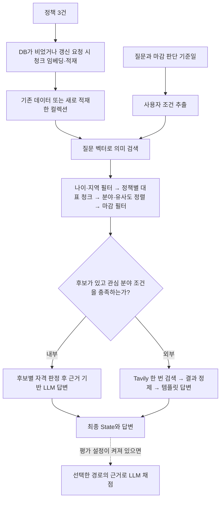

# 이젠, 안쉼 면접 대비 실습

질문 하나가 어떤 정책 청크와 연결되고, 어떤 근거로 답변까지 이어지는지 추적하는 실습이다. 먼저 `main.py`에서 데이터 준비, 그래프 실행, 사후 평가의 경계를 읽고, `workflow.py`에서 선택한 경로 하나를 따라가면 된다.

포트폴리오 p.12의 **원본 26,803건, 청크 33,950개, 10문항 평균 4.6 / 4.2 / 4.1**은 팀 프로젝트의 기록이다. 이 디렉터리의 입력은 정책 **3건**, 청크 **4개**다. 여기서 출력하는 Judge 점수는 지금 실행한 질문 한 건의 결과다.

## 질문 하나의 흐름



| 읽는 순서·파일 | 입력 → 처리 → 출력 | 관련 페이지 |
|---|---|---|
| 1. `main.py`, `config.py` | 설정 → 컬렉션 준비 → `graph.invoke` → 결과 출력 → 선택적 평가 | p.9~12 |
| 2. `workflow.py` | `GraphState`에 query·as_of로 시작. 노드는 변경한 키만 반환하고 조건부 엣지가 답변 경로 하나를 선택 | p.9~11 |
| 3. `policies.py`, `indexing.py` | 정책 목록 → `build_chunks` → 본문을 `embed_texts`로 일괄 임베딩 → `index_chunks`로 Chroma에 upsert | p.9~10, 12 |
| 4. `conditions.py`, `retriever.py` | `extract_conditions`로 사용자 조건 추출. `search_chunks`의 청크들을 필터·병합·정렬한 뒤 `check_sufficiency`가 충분 여부와 이유를 반환 | p.9~11 |
| 5. `answer.py`, `external_search.py` | 내부는 `build_internal_context`에서 `conditions.check_eligibility`를 후보당 한 번 실행. 외부는 `search_external`과 `refine_external_results`로 제목·본문 일부·URL 확보 | p.10~11 |
| 6. `evaluation.py` | `evaluate_answer`가 최종 질문·날짜·답변과 실제 경로의 근거를 받아 세 점수와 이유를 반환 | p.11~12 |

**왜 조건을 두 번 보나?** 검색 필터는 이미 알려진 나이·지역과 충돌하는 후보를 제외한다. 나이를 말하지 않은 사용자는 연령 필터를 건너뛰므로 관련 정책이 남을 수 있다. 자격 판정에서는 같은 경우를 ‘사용자 나이 정보 없음’으로 기록한다. 세 샘플에는 세부 자격 검증 정보가 생략되어 있다. 나이와 지역이 모두 맞아도 `needs_detail_check`의 기본값이 참이어서 추가 확인이 남는다.

**어떤 값이 다음 노드에 남나?** 검색 노드의 `retrieved_results`는 청크 단위다. 정리 노드는 `candidates`와 단계별 개수를 추가한다. 충분성 노드는 `sufficient`와 `reason`을 쓴다. 조건부 엣지는 이 값을 읽기만 한다. 내부 경로는 `internal_context`, 외부 경로는 `external_results`를 남긴다. 양쪽 모두 `answer`와 `answer_source`로 끝난다.

## 실행

아래 명령은 `mini3/interview-practice` 디렉터리에서 실행한다. 기존 `test_env`를 계속 사용할 수 있다. 새 환경에서는 `python -m pip install -r requirements.txt`로 검증한 패키지 버전을 설치한다. 기존 환경 파일이 없는 경우에만 `.env.example`을 `.env`로 복사하고 키 값을 입력한다.

```console
conda activate test_env
python main.py
```

내부 임베딩·조건 추출·답변·평가에는 `OPENAI_API_KEY`가 필요하다. 외부 검색은 `TAVILY_API_KEY`를 쓴다. Tavily 키가 없을 때는 기존 실습처럼 빈 결과로 처리한다. Chroma 조회 화면은 저장된 자료를 그대로 읽으며 API 키를 사용하지 않는다.

| 실험 설정 (`config.py`) | 기본값과 바꾸어 볼 내용 |
|---|---|
| `QUERY` | “월세 지원 정책 알려줘”. 나이·지역이 있는 질문으로 바꿔 추출 조건 비교 |
| `AS_OF` | `None`은 실행 당일. 파일에 `from datetime import date`를 추가하고 `date(2026, 6, 1)`로 설정하면, 기본 질문에서 주거로 추출되고 나이·지역이 비어 있을 때 대전 월세 정책이 남는다. 2026-09-10 이후에는 세 샘플 모두 마감되어 외부 경로로 간다. |
| `FETCH_K` | 4. 조건을 걸기 **전**의 청크 수. 줄이면 적격 정책도 후보에 들어오지 못할 수 있다. |
| `UPDATE_INDEX` | False. 새 DB에서는 최초 적재, 기존 DB에서는 재사용. True면 같은 ID의 본문과 메타데이터를 갱신한다. 사라진 ID는 자동 삭제되지 않는다. |
| `RUN_EVALUATION` | True. 답변만 비교할 때는 False로 두면 마지막 모델 호출을 생략한다. |
| `VERBOSE` | False. True로 두면 원래 검색된 청크 ID·유사도와 최종 State 키가 추가된다. |

**Chroma 조회 화면**은 `python -m streamlit run chroma_viewer.py`로 실행한다. 표에서 ID·본문·메타데이터를 확인하고 한 청크를 선택하면 벡터 차원과 앞의 10개 값이 보인다. 전체 차원도 펼칠 수 있다. 같은 설정의 `practice_vector_db/`와 컬렉션 `youth_policy`를 사용한다.

**정책 데이터 조회 화면**은 `python -m streamlit run policy_viewer.py`로 실행한다. 별도의 `data/youth_policies_raw_200.json`과 `data/youth_policies_normalized.json`을 준비했을 때 원본과 정규화 결과를 비교하는 기존 도구다.

## 이전 파일과 비교

기존 여섯 단계 파일은 `legacy/`에 있다. DB의 상대경로를 맞추려면 현재 실습 디렉터리에서 `python legacy/step14_rag.py` 또는 `python legacy/step16_langgraph.py`로 실행한다. 전자는 일반 Python의 if 분기, 후자는 같은 기능의 그래프 분기를 보여준다. 기존 기본 기준일은 서로 다르므로 결과를 비교할 때는 질문과 날짜를 맞춘다. `step03_embedding.py`와 `step15_langgraph.py`는 가져오기만 해도 API를 호출하며 `step05_chroma.py`는 기존 설정대로 인덱스 갱신이 켜져 있다.

| 이전 위치 | 현재 복습 위치 |
|---|---|
| step14의 정책·청킹·적재 | `policies.py`, `indexing.py` |
| step14의 조건 추출·자격 판정 | `conditions.py` |
| step14의 검색·후보 처리·충분성 | `retriever.py` |
| step14의 웹 검색·정제 / 근거·답변 | `external_search.py` / `answer.py` |
| step16의 State·노드·분기 / 평가 / 실행·출력 | `workflow.py` / `evaluation.py` / `main.py` |

`requirements.txt`는 직접 사용하는 패키지와 버전을, `.env.example`은 필요한 키 이름을 담는다. `.gitignore`는 개인 키·실습 DB·Python 캐시를 제외한다.

## 한계와 다음 실험

- 정책을 대표하는 청크 하나를 고르므로 같은 정책의 다른 조각에 있는 근거가 빠질 수 있다. 유사도가 같으면 먼저 검색된 청크가 남는다.
- 지역은 문자열 일치로 비교한다. 사용자가 값을 생략한 경우에는 후보를 남기지만 정책 자체의 필드가 없거나 형식이 다르면 별도 정규화가 필요하다. 마감일 당일은 후보로 유지하고 시작일·시각은 검사하지 않는다.
- 충분성은 후보 존재와 관심 분야 일치로 판단한다. 원 프로젝트 p.11의 핵심어 일치율이나 필수 단어 검사까지 구현한 실험은 아니다. 외부 URL의 fragment·끝 슬래시는 정리하지만 제목이나 내용이 같은 다른 URL은 남을 수 있다.
- 평가는 생성과 같은 모델로 수행한다. 점수는 프롬프트와 근거 품질의 영향을 받으며 실습은 점수 범위를 검증하지 않는다. 낮은 점수에 따른 자동 재검색은 없다.
- 확장할 때는 공식 정책 100~300건을 같은 정책 레코드 형식으로 정규화해 `build_chunks`에 전달한다. 이후 임베딩을 배치 단위로 적재하고, 동일한 질문·기준일로 FETCH_K와 사전/사후 필터를 비교한다. 정답 근거 포함 여부와 외부 검색 횟수를 함께 기록할 수 있다. 이 수집·비교는 후속 실험이다.
